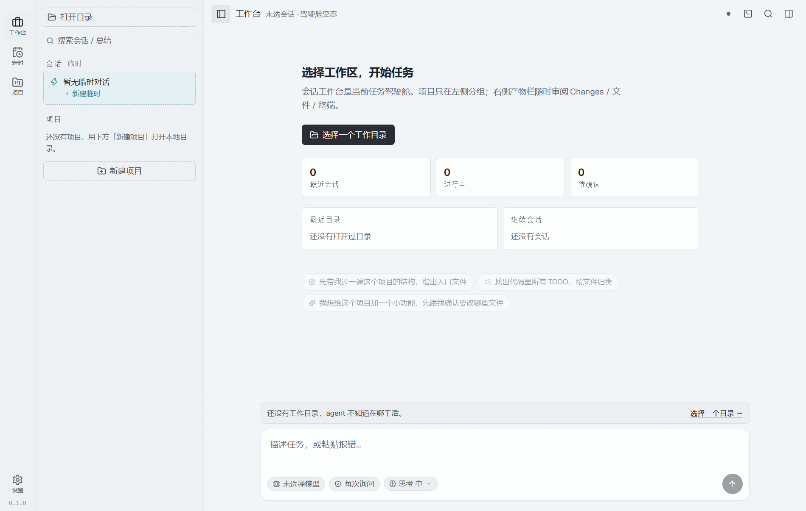
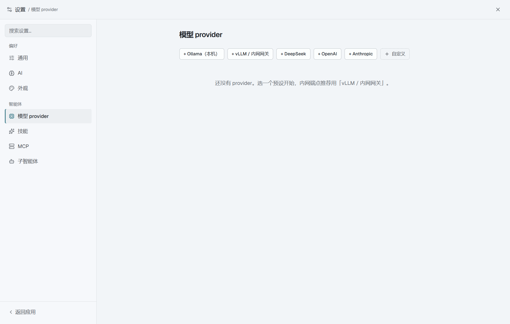
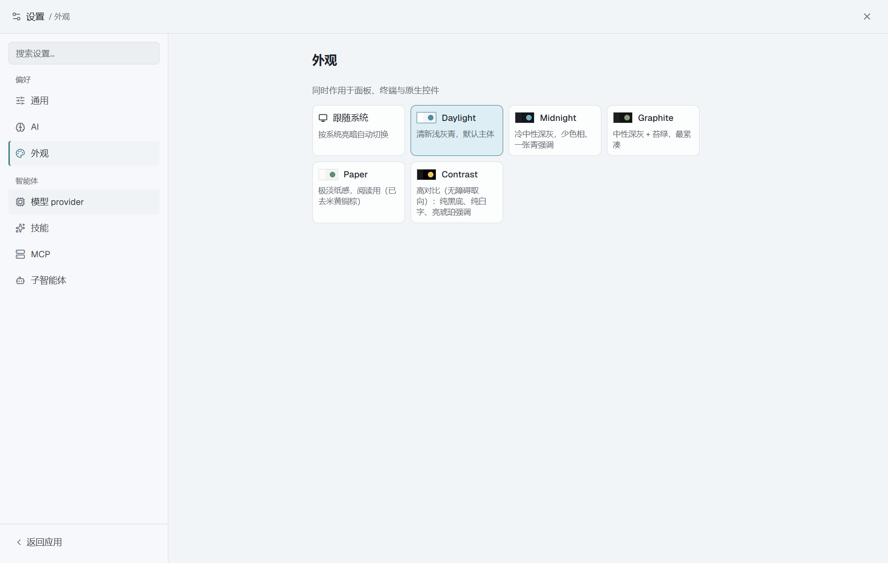
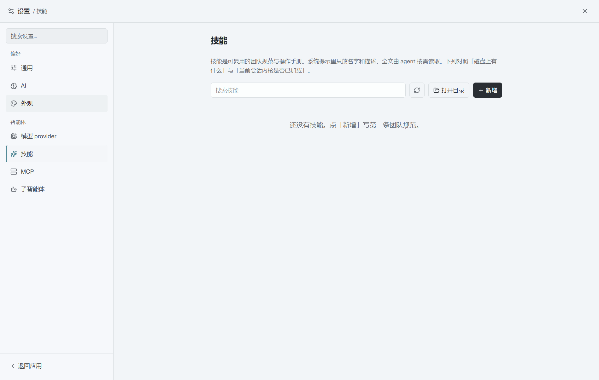

# i-pi-desk

本地优先的 AI 编程桌面客户端。代码与密钥留在本机，模型可以指向公网、DeepSeek，或你内网的 Ollama / vLLM。

> 从零仿写的独立实现。架构参考 [`vastsa/PI-Desktop`](https://github.com/vastsa/PI-Desktop)（**不含**其任何源码；上游为 LGPL）。真正复用的是 MIT 的 [`@earendil-works/pi-*`](https://www.npmjs.com/package/@earendil-works/pi-coding-agent) agent 内核。

---

## 亮点

| | |
|---|---|
| **本地优先** | 会话、工作区、密钥都在本机；密钥走系统密钥环（Windows DPAPI），不落明文 |
| **审批看得见后果** | 改文件前先给你真 diff；`readonly` / `ask` / `auto` 三档，危险命令在 `auto` 下也会强制询问 |
| **三进程边界** | React 渲染层 → Electron 主进程（编排 + 数据 owner）→ Node agent sidecar（内核 + 工具） |
| **内网一等公民** | Ollama / vLLM / 企业网关按预设即可接入，本机无鉴权端点也能用 |
| **可扩展** | Skills（渐进式加载）、MCP、子智能体；插件跑在独立子进程 |
| **工程可验证** | `pnpm verify` 一条链，**1449 条断言**（含渲染层端到端） |

---

## 截图

<p align="center">
  
  <br />
  <em>工作台：选目录、看会话、直接描述任务</em>
</p>

<p align="center">
  
  <br />
  <em>模型 provider：Ollama / vLLM / DeepSeek / OpenAI / Anthropic / 自定义</em>
</p>

<p align="center">
  
  <br />
  <em>定时任务：列表 + 详情的主从布局</em>
</p>

<p align="center">
  
  <br />
  <em>外观：跟随系统 / Daylight / Midnight / Graphite / Paper / Contrast</em>
</p>

<p align="center">
  
  <br />
  <em>技能：可复用的团队规范，按需加载、不占满上下文</em>
</p>

---

## 使用指南

### 1. 环境

| 依赖 | 版本 |
|---|---|
| Node.js | ≥ 22.19 |
| pnpm | ≥ 10 |
| 系统 | Windows（当前验证主战场；mac/linux 产物未交付） |

不需要 Rust 工具链。

### 2. 安装并启动

```bash
pnpm install
pnpm dev
```

`pnpm dev` 会自行确保 Electron 二进制、构建 `packages/*`，再打开窗口。

打包安装版：

```bash
pnpm --filter @i-pi-desk/desktop run dist
# 产物在 apps/desktop/release/
```

### 3. 配置模型（必做）

1. 左侧点 **设置** → **模型 provider**
2. 选一个预设：
   - **Ollama（本机）**：本地模型，通常无需真实 API Key
   - **vLLM / 内网网关**：企业 OpenAI 兼容端点
   - **DeepSeek / OpenAI / Anthropic**：公网厂商
3. 填 Base URL（如需要）与 API Key → **测试连接** → **保存**
4. 回到工作台，在输入框下方 chip 里选中模型

> API Key 只保存在本机密钥环里，**不会**进仓库。本 README 与截图均不包含任何真实密钥。

### 4. 第一次对话

1. 点 **选择一个工作目录**（或侧栏「新建项目」）
2. 在输入框描述任务，例如：「带我过一遍这个项目的结构」
3. 权限默认是 **每次询问**：agent 要写文件 / 跑命令时，聊天里会就地弹出审批卡，可看 diff 后再允许 / 拒绝 / 允许并记住
4. 运行中可随时 **停止**；卡在审批上也能停

### 5. 常用能力

| 你想… | 怎么做 |
|---|---|
| 换主题 | 设置 → 外观 |
| 调思考强度 / 权限档 | 设置 → AI，或输入框下方 chip |
| 写团队规范 | 设置 → 技能 → 新增 |
| 接 MCP | 设置 → MCP |
| 配子智能体 | 设置 → 子智能体 |
| 定时跑任务 | 左侧「定时」→ 新建任务 |
| 命令面板 | `Ctrl+K` |
| 键盘地图 | `?` |

### 6. 数据在哪

Windows 默认：`%APPDATA%\i-pi-desk`

```
settings.json      # 设置与 provider 列表（无明文密钥）
secrets.json       # 系统密钥环加密的 API Key
sessions/          # 一个会话一个 JSON
skills/            # 技能目录
plugins/           # 插件
logs/
```

设置页底部也能看到当前数据目录。

### 7. 终端面板（可选）

终端依赖原生模块 `node-pty`。不编也能启动，只是终端显示「不可用」：

```bash
pnpm rebuild:pty
```

---

## 开发

```bash
pnpm install
pnpm dev              # 开发（含热重载）
pnpm typecheck        # 全量类型检查
pnpm test             # 桌面 / 共享层单测
pnpm verify           # 全量校验链（推荐改完必跑）
pnpm pack             # 解包目录（注意：不是 pnpm 内置的 pack）
```

国内网络建议：

```powershell
$env:ELECTRON_MIRROR='https://npmmirror.com/mirrors/electron/'
$env:ELECTRON_BUILDER_BINARIES_MIRROR='https://npmmirror.com/mirrors/electron-builder-binaries/'
```

### 三条不变式

1. **渲染层不碰文件系统** —— IO 走 preload → 主进程  
2. **主进程不跑 agent** —— 内核只在 sidecar  
3. **`pi-*` 只能出现在 `packages/agent-host`** —— 别处 import 会被守卫拦住  

### 目录结构

```
i-pi-desk/
├─ packages/
│  ├─ shared/       # IPC / Result / 领域模型（不依赖 Electron / pi-*）
│  └─ agent-host/   # sidecar：pi 封装、审批、事件翻译
└─ apps/desktop/
   ├─ electron/main/     # 窗口、IPC、持久化、密钥、监督 sidecar
   ├─ electron/preload/  # 白名单暴露 window.desk
   └─ src/               # React 渲染层
```

更细的架构与踩坑：[`docs/ARCHITECTURE.md`](docs/ARCHITECTURE.md) · [`docs/AGENT-HANDOFF.md`](docs/AGENT-HANDOFF.md) · [`docs/HANDOVER.md`](docs/HANDOVER.md) · [`docs/UI-DESIGN.md`](docs/UI-DESIGN.md)

---

## 自测覆盖了什么

这些不是「跑个例子看看」，而是针对**已知会出错的地方**写的断言。

| 命令 | 覆盖 |
|---|---|
| `pnpm test` | 插件 manifest、provider key、窗口恢复、diff 配对、工作区越界、技能文件、PTY 失败归因、关窗拦截、会话过滤等 |
| `pnpm verify:plugins` | **16 条**：工具真在子进程执行、环境变量被裁剪、停用无残留 |
| `pnpm verify:history` | **28 条**：重启后模型仍记得；对照组证明失忆路径真的失忆 |
| `pnpm verify:approval-timeout` | **16 条**：超时按拒绝；手动放行对照 |
| `pnpm verify:anthropic-history` | **33 条**：真实 Anthropic 请求构建合法性 |
| `pnpm verify:api-matrix` | **36 条**：四种协议真实请求构建 |
| `pnpm verify:anthropic-tool-loop` | **20 条**：工具往返报文形状 |
| `pnpm verify:allow-always` | **12 条**：「允许并记住」生命周期 |
| `pnpm verify:deny-feedback` | **18 条**：拒绝后模型看到的内容 |
| `pnpm verify:tools-download` | **20 条**：rg/fd 查找与失败路径 |
| `pnpm verify:no-persistence` | **13 条**：内核侧不落盘对话 |
| `pnpm verify:diff-preview` | **17 条**：审批差异预览内容 |
| `pnpm verify:project-trust` | **10 条**：工作区 `.pi/` 默认关闭 |
| `pnpm verify:doc-claims` | **52 条**：文档承诺与数字自洽 |
| `pnpm verify:danger-gate` | **26 条**：`auto` 下危险命令仍要问 |
| `pnpm verify:approval-policy` | **53 条**：三种模式 × 各类工具策略表 |
| `pnpm verify:plugin-failure` | **26 条**：插件失败路径与泄漏修复 |
| `pnpm verify:plugin-orphan` | **7 条**：崩溃后不留孤儿进程 |
| `pnpm verify:contract` | **21 条**：控制面 HTTP 契约 |
| `pnpm verify:kernel-deps` | **26 条**：内核依赖与许可边界 |
| `pnpm verify:protocol` | **9 条**：sidecar stdout 协议流 |
| `pnpm verify:renderer` | **405 条**：CDP 驱动真实窗口端到端 |
| `pnpm verify:bundle` | **8 条**：渲染层体积与按需 chunk |
| `pnpm verify:packaged` | **24 条**：打包产物真启动 |
| `pnpm verify:packaging` | **15 条**：打包配置与产物名 |
| **合计** | **1449 条断言**（数出来的；与 `docs/ARCHITECTURE.md` §15.10 对账） |

`pnpm verify` 一次跑完链内脚本。打包两步需先出产物后单独跑。

---

## 许可与第三方

见 [`THIRD-PARTY.md`](THIRD-PARTY.md)。内核 `@earendil-works/pi-*` 为 MIT；上游 PI-Desktop 仅作架构参照、零复制。
